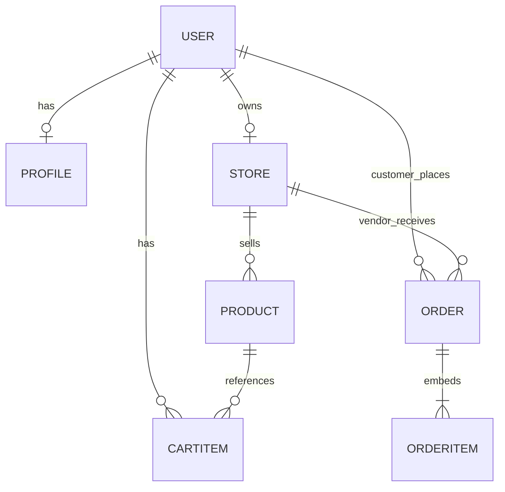

# ERD Draft — GreenBasket

Author: Zeeshan Razzaq
Date: 2026-11-21
Status: Draft before Chapter 5 implementation

## Diagram

Each ORDER document contains an embedded array `orderItems` with `nameAtPurchase`, `priceAtPurchase`, `unitAtPurchase`, `quantity`, `productId`.

## Collection inventory

| Collection | Purpose         | Key fields                                             |
| ---------- | --------------- | ------------------------------------------------------ |
| users      | login identity  | email, passwordHash, role                              |
| profiles   | display info    | userId ref, displayName                                |
| stores     | vendor shop     | userId ref, name, address                              |
| products   | listings        | storeId ref, name, price, unit, stockQty, isPerishable |
| cartitems  | shopping cart   | userId, productId, storeId, quantity                   |
| orders     | checkout result | customerId, storeId, status, orderItems[] embedded     |

## Embed vs reference audit

**User → Profile (reference).** Profiles live in their own collection and point to the user through `userId`. Login data (email, passwordHash, role) is sensitive and read on every auth check, while display data is read only when showing a profile. Keeping them separate means auth queries never load extra fields.

**User → Store (reference).** A vendor owns one store, linked by `userId`. The store has its own lifecycle (products, incoming orders) and is queried independently of the user, so embedding it inside the user document would bloat it and tie two unrelated concerns together.

**Store → Products (reference).** A store can list many products, and each product's price and stock change often. Embedding products in the store would create a large, unbounded array that is rewritten on every stock update. Products are also searched and listed across stores, which needs their own collection.

**CartItem → User, Product, Store (reference).** A cart item stores `userId`, `productId` and `storeId`. Product price and stock must stay live while the item sits in the cart, so it references the product rather than copying it. `storeId` is included because this is a multi-vendor marketplace and checkout must split items by vendor.

**Order → OrderItems (embed).** Order lines belong to exactly one order, are always read together with it, and never change after checkout. They are embedded as an array, with snapshot fields (`nameAtPurchase`, `priceAtPurchase`, `unitAtPurchase`, `quantity`, `productId`). The snapshot keeps order history correct even if the product's price or name changes later or the product is deleted.

**Order → Customer and Store (reference).** `customerId` and `storeId` point to the user and store, which exist independently and are queried on their own (a customer's order history, a vendor's incoming orders).
