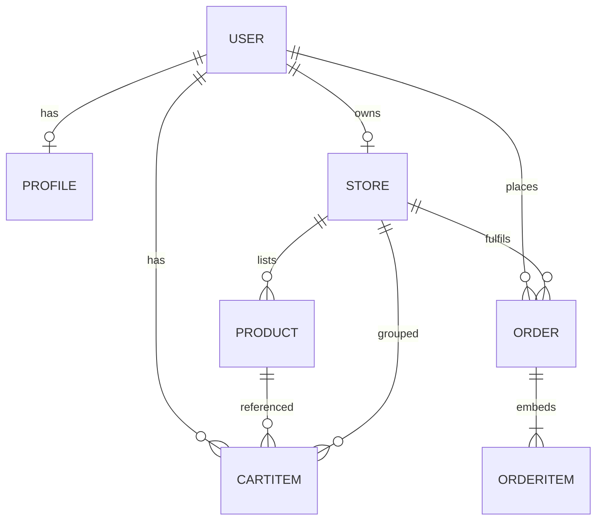

# Final ERD — GreenBasket

Author: Zeeshan Razzaq
Date: 2026-11-26
Status: Final, synced with Mongoose models (Chapter 5)

## Diagram



`ORDERITEM` is an embedded sub-schema inside `orders`, not a separate collection.

## Collections

All collections also have `createdAt` and `updatedAt` (Mongoose `timestamps: true`).

### users

| Field            | Type        | Required | Index  | Notes                                |
| ---------------- | ----------- | -------- | ------ | ------------------------------------ |
| email            | String      | yes      | unique | lowercase, trimmed, format validated |
| passwordHash     | String      | yes      |        | min length 60 (bcrypt)               |
| role             | String enum | yes      |        | vendor \| customer                   |
| isVerified       | Boolean     | yes      |        | default false                        |
| refreshTokenHash | String      | no       |        | used in Chapter 6                    |

### profiles

| Field       | Type                | Required | Index  | Notes                         |
| ----------- | ------------------- | -------- | ------ | ----------------------------- |
| userId      | ObjectId (ref User) | yes      | unique | enforces one profile per user |
| displayName | String              | yes      |        |                               |
| phone       | String              | no       |        |                               |
| avatarUrl   | String              | no       |        |                               |

### stores

| Field       | Type                | Required | Index  | Notes                |
| ----------- | ------------------- | -------- | ------ | -------------------- |
| name        | String              | yes      |        | public shop name     |
| slug        | String              | yes      | unique | lowercase, URL-safe  |
| description | String              | no       |        |                      |
| address     | String              | no       |        |                      |
| logoUrl     | String              | no       |        |                      |
| userId      | ObjectId (ref User) | yes      | unique | one store per vendor |
| isActive    | Boolean             | yes      |        | default true         |

### products

| Field            | Type                 | Required | Index    | Notes                                                                    |
| ---------------- | -------------------- | -------- | -------- | ------------------------------------------------------------------------ |
| name             | String               | yes      |          |                                                                          |
| description      | String               | no       |          |                                                                          |
| price            | Number               | yes      |          | per unit, min 0                                                          |
| unit             | String enum          | yes      |          | each \| bunch \| kg \| g \| L \| ml \| pack                              |
| weightOrQuantity | Number               | no       |          | pack size hint, min 0                                                    |
| stockQty         | Number               | yes      |          | integer, min 0, default 0                                                |
| isPerishable     | Boolean              | yes      |          | default false                                                            |
| category         | String enum          | yes      |          | produce \| dairy \| bakery \| pantry \| frozen \| beverages \| household |
| isPublished      | Boolean              | yes      | compound | default false (draft)                                                    |
| imageUrl         | String               | no       |          | default null                                                             |
| storeId          | ObjectId (ref Store) | yes      | yes      | ownership; no userId on product                                          |

### cartitems

| Field     | Type                   | Required | Index           | Notes                                   |
| --------- | ---------------------- | -------- | --------------- | --------------------------------------- |
| userId    | ObjectId (ref User)    | yes      | yes             | cart owner                              |
| productId | ObjectId (ref Product) | yes      | compound unique | live reference, price read from Product |
| storeId   | ObjectId (ref Store)   | yes      |                 | denormalised for checkout split         |
| quantity  | Number                 | yes      |                 | integer, min 1                          |

### orders

One order is one vendor's portion of a checkout.

| Field                 | Type                 | Required | Index | Notes                                                         |
| --------------------- | -------------------- | -------- | ----- | ------------------------------------------------------------- |
| customerId            | ObjectId (ref User)  | yes      | yes   | buyer                                                         |
| storeId               | ObjectId (ref Store) | yes      | yes   | fulfilling vendor                                             |
| status                | String enum          | yes      |       | pending \| packed \| dispatched \| cancelled, default pending |
| paymentStatus         | String enum          | yes      |       | pending \| paid \| failed, default pending                    |
| stripePaymentIntentId | String               | no       |       | set in Chapter 19                                             |
| orderItems            | [OrderItem]          | yes      |       | embedded, at least one item                                   |
| subtotal              | Number               | yes      |       | sum of line totals, min 0                                     |

### orders.orderItems (embedded sub-schema)

| Field           | Type                   | Required | Notes                                      |
| --------------- | ---------------------- | -------- | ------------------------------------------ |
| productId       | ObjectId (ref Product) | yes      | traceability, product may be deleted later |
| nameAtPurchase  | String                 | yes      | snapshot                                   |
| priceAtPurchase | Number                 | yes      | snapshot, min 0                            |
| unitAtPurchase  | String                 | yes      | snapshot                                   |
| quantity        | Number                 | yes      | integer, min 1                             |
| lineTotal       | Number                 | yes      | priceAtPurchase x quantity                 |

## Ownership chain

```
User._id  <-- Store.userId
Store._id <-- Product.storeId
Store._id <-- Order.storeId
```

A vendor owns exactly one store through `Store.userId`. A product belongs to a vendor only through its store (`Product.storeId`), so there is no `userId` on Product. Later, `assertStoreOwner(storeId, userId)` loads the store and compares `store.userId` with the logged-in user, returning 403 on mismatch. A vendor reads orders with `Order.find({ storeId: myStoreId })`.

## Indexes

| Collection | Index                                | Purpose                       |
| ---------- | ------------------------------------ | ----------------------------- |
| users      | `{ email: 1 }` unique                | login, no duplicate accounts  |
| profiles   | `{ userId: 1 }` unique               | one profile per user          |
| stores     | `{ userId: 1 }` unique               | one store per vendor          |
| stores     | `{ slug: 1 }` unique                 | public URL                    |
| products   | `{ storeId: 1 }`                     | vendor product list           |
| products   | `{ storeId: 1, isPublished: 1 }`     | catalogue queries             |
| cartitems  | `{ userId: 1 }`                      | fetch cart                    |
| cartitems  | `{ userId: 1, productId: 1 }` unique | one line per product per user |
| orders     | `{ storeId: 1 }`                     | vendor reads own orders       |
| orders     | `{ customerId: 1 }`                  | customer order history        |

## Seed data

Seed is idempotent (upsert), so re-running it does not create duplicates.

| Entity    | Count                                  |
| --------- | -------------------------------------- |
| Users     | 4                                      |
| Profiles  | 4                                      |
| Stores    | 2                                      |
| Products  | 12 (6 per store: 5 published, 1 draft) |
| CartItems | 0                                      |
| Orders    | 0                                      |

Test accounts (password for all: `Password123!`): vendor-a@test.local, vendor-b@test.local, customer-a@test.local, customer-b@test.local.
Stores: `vendor-a-market`, `vendor-b-market`.

## Diff from draft

- Users: added `isVerified` and `refreshTokenHash` for the auth chapters.
- Profiles: confirmed the User/Profile split; added `phone` and `avatarUrl`.
- Stores: added `slug`, `description`, `logoUrl` and `isActive`.
- Products: added `isPublished`, `category`, `description`, `weightOrQuantity` and `imageUrl`; unit and category are fixed enums.
- Cart items: added a unique `{ userId, productId }` index so each product has one cart line per user.
- Orders: added `paymentStatus`, `stripePaymentIntentId`, `subtotal` and `lineTotal` on order lines, plus indexes on `storeId` and `customerId` for vendor and customer lookups.
- Order items stayed embedded, as planned in the draft, with snapshot fields.
